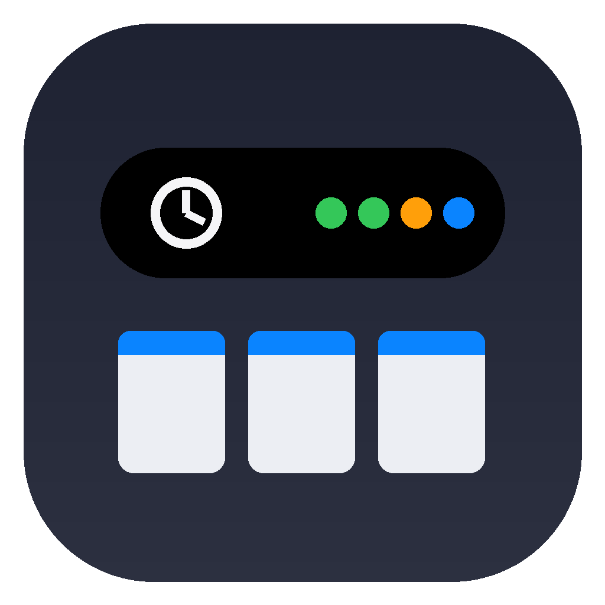
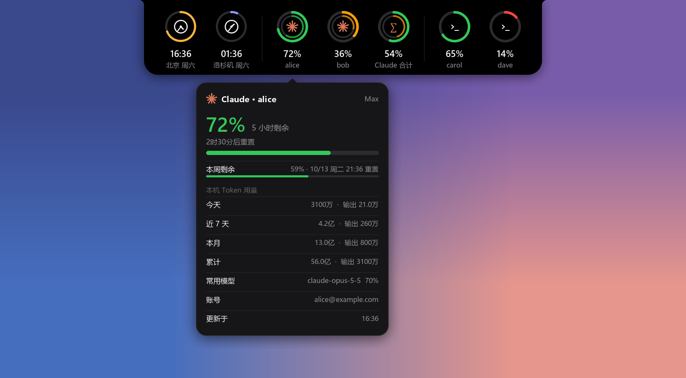
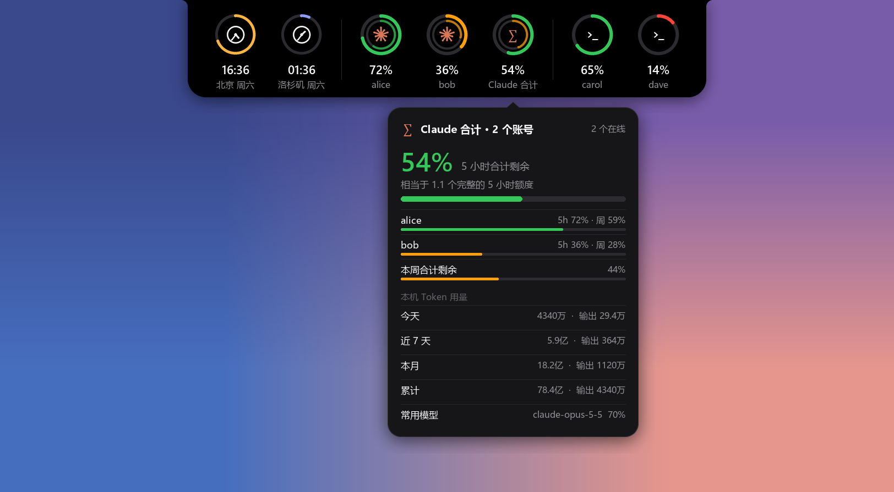
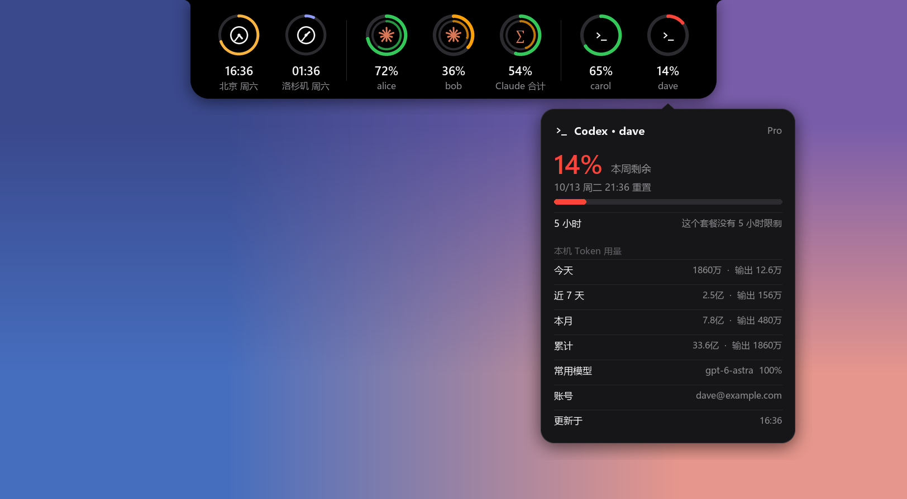
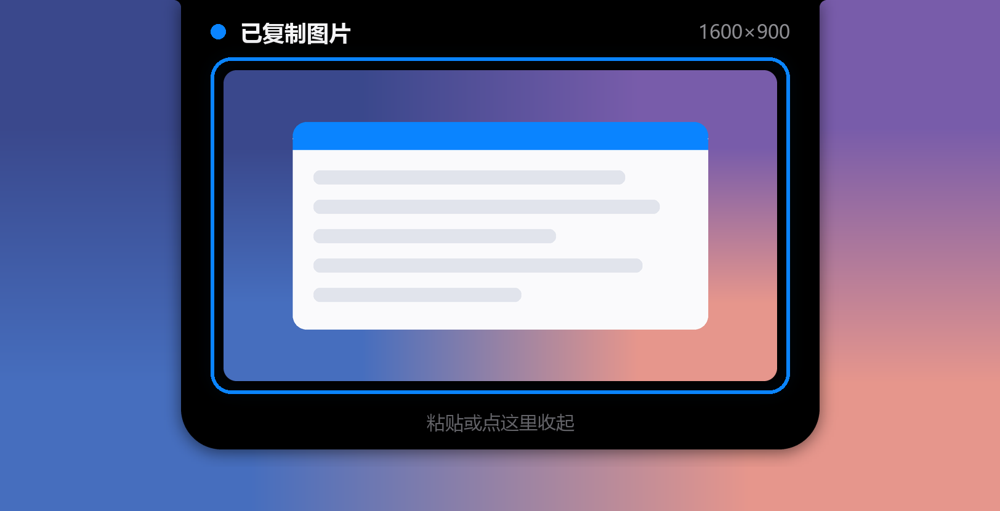
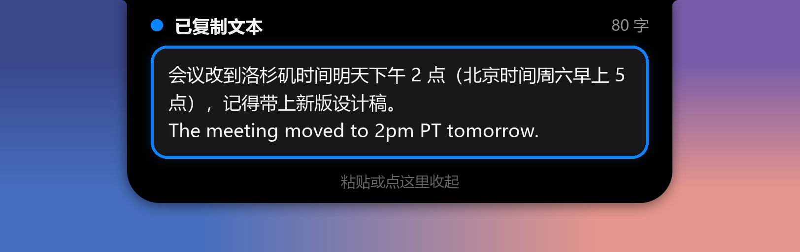

<div align="center">



# windowsAI灵动岛

**给 Windows 做的“灵动岛”：屏幕顶部一个黑色小条，鼠标一碰就展开——**
**时间、Claude / Codex 额度和 token 用量、复制截图提示、窗口悬挂、休息提醒，都在这里。**



</div>

## 功能

### 🕐 双时区时钟 + AI 额度一眼看
平时是屏幕顶部正中的一个小黑条，显示北京 / 洛杉矶时间，右边几个小圆点代表各账号额度（绿 / 橙 / 红）。


鼠标移上去展开成一排圆环：

| 圆环 | 外圈 | 内圈 |
|---|---|---|
| 北京、洛杉矶 | 今天过了多少（白天橙色，夜里紫色） | — |
| 每个 Claude 账号 | 5 小时额度剩余 | 本周额度剩余 |
| Claude 合计 | 所有 Claude 账号平均剩余 | 本周平均剩余 |
| 每个 Codex 账号 | 5 小时（套餐没有时显示本周）剩余 | 本周剩余 |

停在某个圆环上会弹出详情卡片：剩余百分比、什么时候重置、**本机 token 用量**（今天 / 近 7 天 / 本月 / 累计、常用模型）。

| Claude 合计 | Codex 账号 |
|---|---|
|  |  |

### 📋 复制 / 截图后弹出预览
截图（Win+Shift+S、PrtSc）或复制任何东西后，灵动岛弹出来用蓝框框住内容：图片显示缩略图和尺寸，文字显示前几行和字数，文件显示文件名。**按 Ctrl+V 粘贴或点一下框才收回**。密码管理器等标记为“别给剪贴板监视器看”的内容只提示、不显示。

| 截图 | 文字 |
|---|---|
|  |  |

### 🪟 拖窗口到灵动岛 → 悬挂在屏幕顶部
把任意窗口拖到灵动岛上松手，它就缩小、置顶，挂在屏幕顶部（最多 3 个），不会被其它软件盖住，你照常用别的软件。灵动岛右侧出现这些窗口的图标和 ×：点图标单独还原，点 × 全部结束悬挂，**窗口回到原来的位置、大小和最大化状态**。


### ☕ 休息提醒
连续用电脑 90 分钟，灵动岛展开提醒你休息，2 秒后自动收回。离开电脑超过 5 分钟（或电脑睡眠过）就算休息过，重新计时。


### 🌐 划词时区换算
在任何软件里选中一段带时间的文字（“下午两点”“2pm PT”“明天 10am ET”“9月30日 上午十点一刻”……），选区下方弹出它在洛杉矶 / 纽约 / 北京分别是几点，夏令时也算对。

## 安装

### 直接用（推荐）
到 [Releases](../../releases) 下载 `WindowsAI-Island.exe`，双击运行。右键灵动岛可以设置开机自启。

### 从源码运行
需要 Windows 10/11、Python 3.10+：

```bash
pip install -r requirements.txt
```

然后双击 `启动.bat`（或 `pythonw notch.pyw`）。

### 自己打包 exe
```bash
pip install -r requirements.txt pyinstaller
build.bat
```
生成 `dist\WindowsAI-Island.exe`。

## 账号设置

- **Claude**：读的是 Claude Code 登录后留下的 `~/.claude/.credentials.json`。第一个账号就是你命令行里登录的那个。
  第二个账号：右键灵动岛 →「登录账号」→「Claude 账号2」，会在单独的目录 `~/.claude-usage-2` 里打开登录（浏览器授权），不影响你原来的登录。
- **Codex**：第一个账号读 `~/.codex/auth.json`（Codex 当前登录的账号）。第二个账号同样从右键菜单登录，存在 `~/.codex-usage-2`。
- 账号目录、刷新间隔等都在 `%APPDATA%\WindowsAI-Island\config.json` 里，可以改成更多账号。

## 操作

| 操作 | 效果 |
|---|---|
| 鼠标移到顶部黑条 | 展开面板；停在圆环上看详情 |
| 点圆环 | 立即刷新额度（没登录的账号会打开登录） |
| 右键灵动岛 | 菜单：刷新、划词换算、复制提示及大小、休息提醒、登录账号、结束悬挂、开机自启、退出 |
| 拖窗口到灵动岛松手 | 悬挂窗口 |
| 点右侧图标 / × | 还原单个 / 全部悬挂窗口 |
| 复制后按 Ctrl+V 或点框 | 收起复制提示 |

## 隐私

- 所有东西都在本机运行，没有任何自己的服务器。
- 联网只为了查额度：用你本机已有的登录凭据访问 `api.anthropic.com`（Claude）和 `chatgpt.com`（Codex）的用量接口，凭据过期时向官方地址续期并写回原文件（和 Claude Code / Codex 自己的做法一样）。
- token 统计只读本机的 Claude Code / Codex 日志，不上传。
- 剪贴板内容只在内存里做预览，不保存。

## 实现

纯 Python（tkinter + Pillow + ctypes 调 Win32）：

- 灵动岛是一个逐像素透明的分层窗口（`UpdateLayeredWindow`），所有画面用 Pillow 画出来，透明处鼠标可以穿透；
- 展开 / 收起 / 弹出都是同一个变形动画（缓存圆角拼外形、内容铺黑底后只做亮度淡入、动画期间把系统定时器调到 1ms），每帧 1–18 毫秒；
- 窗口悬挂用 `SetWinEventHook` 监听拖动，`SetWindowPos` / `SetWindowPlacement` 置顶和还原；
- token 统计在独立的低优先级子进程里增量读日志，不卡界面。

| 文件 | 内容 |
|---|---|
| `notch.pyw` | 主程序：灵动岛界面、动画、菜单 |
| `claude_usage.py` / `codex_usage.py` | 读额度、续期凭据 |
| `token_stats.py` | 本机日志 token 统计 |
| `clip_watch.py` | 复制 / 粘贴监听 |
| `window_hang.py` | 窗口悬挂 |
| `timezone_float.pyw` / `timeparse.py` | 划词换算（也能单独当一个时区悬浮窗用） |

## 已知限制

- 额度接口是 Claude Code / Codex 客户端内部用的，不是公开 API，官方改了可能要跟着改。
- 以管理员身份运行的程序（任务管理器、安装程序等）不能被悬挂——Windows 不允许普通程序操纵它们。
- 在右键菜单里点“粘贴”或拖放检测不到，需要点一下框收起复制提示。
- 目前只在主显示器顶部显示。

## 免责声明

非官方项目，与 Anthropic、OpenAI 无关。Claude 是 Anthropic 的商标，Codex / ChatGPT 是 OpenAI 的商标。

## License

[MIT](LICENSE)
